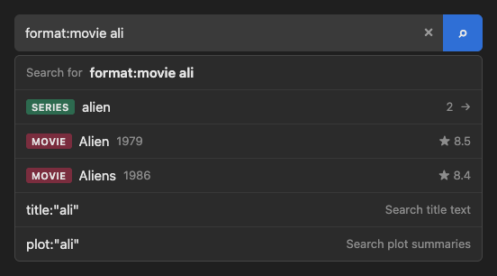

# s.search

[](https://github.com/taetrus/s.search/actions/workflows/deploy.yml)

A search box that understands a small query language, with autocomplete. It searches a mock catalog of science-fiction books, TV series, movies, and comics.

**Try it:** [taetrus.github.io/s.search](https://taetrus.github.io/s.search/). No sign-in or setup is necessary.

Example queries to try:

- `director:"ridley scott"`
- `format:book year:1960..1969 rating:>=8.4`
- `genre:cyberpunk format:movie`
- `blade` (type it and look at the suggestions)



## Features

- **Query language.** Type filters such as `director:"ridley scott"` or `year:>1990` together with plain words.
- **Field shortcuts.** Click the empty box to see all filters. Select a filter to insert it.
- **Tag suggestions.** Type a name to see matching people, series, characters, and genres. Each tag shows the number of works that have it.
- **Title suggestions.** Matching titles appear while you type. The other filters in the query also apply to these titles.
- **Keyboard control.** You can do all steps with the keyboard.

The app has no backend. All data is in `src/data/works.ts`, and all search runs in the browser.

## Tech stack

| Part | Tool |
|---|---|
| UI | React 19 |
| Language | TypeScript 7 |
| Build and dev server | Vite 8 |
| Tests | Vitest 5 |
| Linter | oxlint |
| Hosting | GitHub Pages, deployed by GitHub Actions |

The app uses no UI library and no runtime dependencies other than React.

## Query syntax

All filters and words must match. A query with no filters and no words shows all works.

| Filter | Example | Matches |
|---|---|---|
| `format:` | `format:movie` | `book`, `tv`, `movie`, or `comic` |
| `author:` | `author:"isaac asimov"` | The author of the book, or of the source book of a film or series |
| `director:` | `director:"ridley scott"` | The director |
| `series:` | `series:dune` | The series or franchise |
| `character:` | `character:spock` | A character in the work |
| `genre:` | `genre:"time travel"` | A genre |
| `language:` | `language:french` | A language of the original or of a translation |
| `year:` | `year:1979`, `year:>1990`, `year:1960..1969` | The release year. Use `>`, `>=`, `<`, `<=`, or a range `A..B`. |
| `rating:` | `rating:>=8.5` | The rating from 1 to 10. Use the same operators as `year:`. |
| `added:` | `added:30d` | Works added to the catalog in the last N days |
| `title:` | `title:"martian"` | Text in the title |
| `plot:` | `plot:"wormhole"` | Text in the plot summary |
| plain word | `ripley` | Text in the title, the plot, or any tag name |

Rules:

- Use quotes when a value contains a space: `genre:"space opera"`.
- Do not put a space after the colon. In `director: ridley`, the filter has no value, and `ridley` becomes a plain word.
- Tag filters (`format` to `language`) must match the full tag name. Letter case does not matter.
- An unknown filter or a value that is not valid gives zero results. This shows a typing error immediately.

## Keyboard

| Key | Action |
|---|---|
| <kbd>↑</kbd> <kbd>↓</kbd> | Move through the suggestions |
| <kbd>Enter</kbd> | Use the selected suggestion. If you did not select a suggestion, run the search. |
| <kbd>Tab</kbd> | Use the selected suggestion |
| <kbd>Esc</kbd> | Close the suggestions |

## Run locally

You need Node.js 20.19 or later, or 22.12 or later. The deploy workflow uses Node.js 22.

1. Clone the repository:
   ```bash
   git clone https://github.com/taetrus/s.search.git
   cd s.search
   ```
2. Install the dependencies:
   ```bash
   npm install
   ```
3. Start the development server:
   ```bash
   npm run dev
   ```
4. Open the URL that the server shows, usually http://localhost:5173/.

To open the app from other devices on your network, use `npm run dev -- --host 0.0.0.0`.

## Commands

| Command | Action |
|---|---|
| `npm run dev` | Start the development server with live reload |
| `npm run build` | Check the types, then build the site into `dist/` |
| `npm run preview` | Serve the `dist/` build locally |
| `npm run lint` | Run oxlint |
| `npx vitest run` | Run all tests |
| `npx vitest run src/search/query.test.ts` | Run the tests in one file |

## How it works

The text in the search box is the only state. The app reads it again after each change:

1. `src/search/query.ts` splits the text into tokens and finds the token at the cursor.
2. `src/search/SearchBox.tsx` shows suggestions for that token only.
3. When you select a suggestion, the app replaces that token in the text.
4. When you run the search, `parseQuery` converts the text into filters and words.
5. `src/search/worksApi.ts` checks each work against all filters and words.

The tag suggestions and the search use the same data and the same matching code. Thus the number next to a tag always equals the number of results for that tag.

`src/search/tagApi.ts` and `src/search/worksApi.ts` are local functions. To use a real server, replace the body of `searchTags` and `searchWorks` with `fetch` calls.

### Key files

| File | Contents |
|---|---|
| `src/data/works.ts` | The catalog. This is the only data source. |
| `src/search/query.ts` | Tokenizer, query parser, and text replacement |
| `src/search/SearchBox.tsx` | The search box and the suggestion list |
| `src/search/useLookup.ts` | Delayed, cancellable lookups for the suggestions |
| `src/search/tagApi.ts` | Tag suggestions and tag counts, built from the catalog |
| `src/search/worksApi.ts` | The filter rules and the search |
| `src/App.tsx` | The page and the result cards |

## Change the data

**Add a work:** add an entry to the `DRAFTS` list in `src/data/works.ts`. Write all tag names in lowercase. The new tags appear in the suggestions automatically.

**Add a tag type** (for example `studio`):

1. Add the name to `TAG_TYPES` in `src/search/tagApi.ts`.
2. Add a field for it to the `Work` type in `src/data/works.ts`.
3. Add a `case` for it to `tagValues` in `src/search/tagApi.ts`.
4. Add a `.sb-badge-studio` color to `src/search/SearchBox.css`.

The field shortcuts and the filter rules use the new type automatically.

## Deployment

The live site is at **https://taetrus.github.io/s.search/**.

Each push to `main` starts the workflow in `.github/workflows/deploy.yml`. The workflow runs the tests, the linter, and the build. If all three pass, it publishes `dist/` to GitHub Pages. If one step fails, the live site does not change. The badge at the top of this file shows the result of the last run.

### Deploy your own copy

1. Fork this repository.
2. In your fork, open **Settings → Pages**.
3. Set **Source** to **GitHub Actions**.
4. Open the **Actions** tab. GitHub disables workflows in a fork until you enable them. Click the button that enables them.
5. Run the **Deploy to GitHub Pages** workflow, or push a commit to `main`.

The site then appears at `https://<your-user>.github.io/<repository-name>/`. You do not need to change the code for a different repository name. The build uses relative asset paths (`base: './'` in `vite.config.ts`).

On the GitHub Free plan, GitHub Pages works only for public repositories.

## Credits

The catalog uses the titles, names, and dates of real works for demonstration only. The plot summaries are short original descriptions.

## License

This project uses the [MIT License](LICENSE). You may use, change, and share the code. Keep the copyright notice and the license text in all copies.
